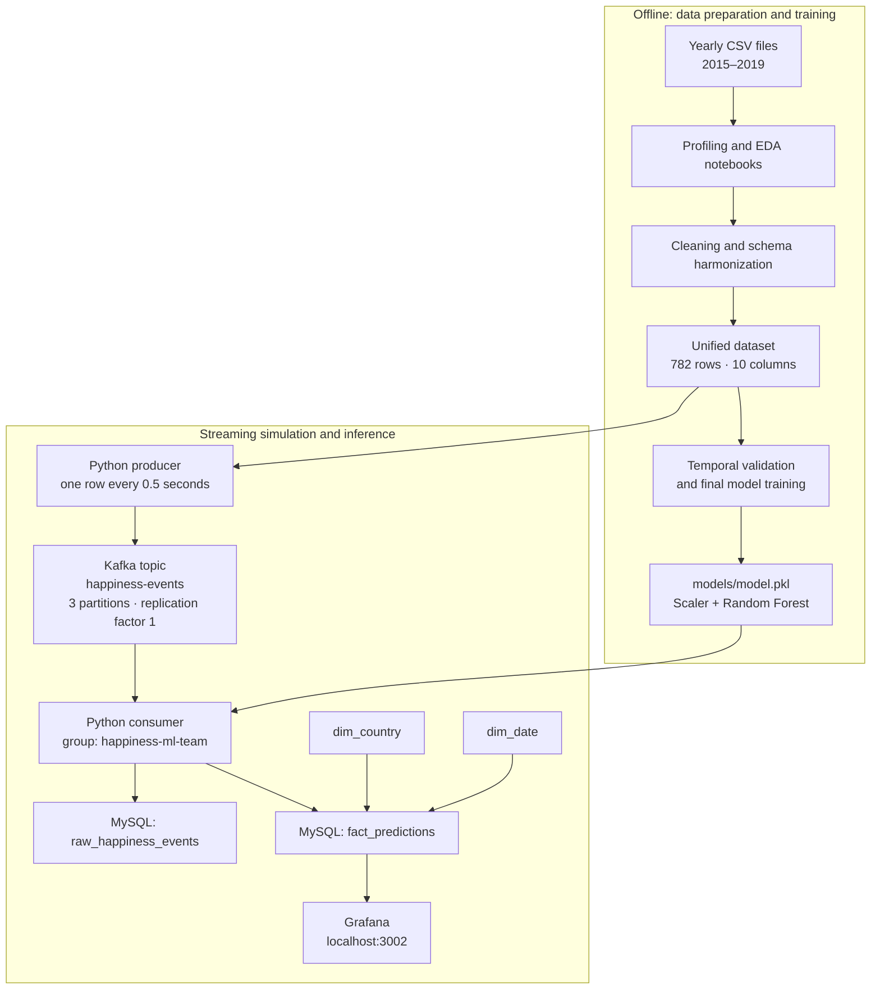
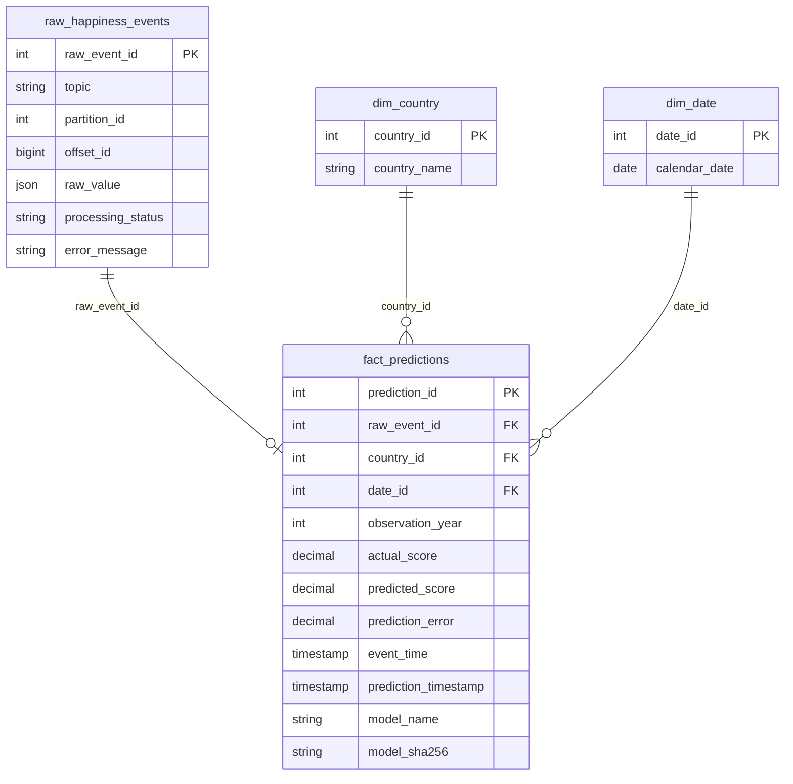

# Happiness ML Streaming Pipeline

A course project that combines five years of World Happiness data into a consistent dataset, trains a regression model, and simulates real-time inference with Apache Kafka. Predictions are stored in a MySQL analytical schema. Docker Compose provides the local Kafka, MySQL, and Grafana services.

> **Scope:** The CSV files are historical and finite. The producer publishes their rows one at a time to simulate streaming; this is not a live feed.

## Project at a glance

- **Source:** World Happiness Report CSV files for 2015–2019.
- **Batch preparation:** pandas notebooks profile, harmonize, and clean the yearly datasets.
- **Model:** a scikit-learn `RandomForestRegressor`, saved with its `StandardScaler` in `models/model.pkl`.
- **Streaming:** a Python producer publishes JSON events to Kafka; a Python consumer validates them and predicts happiness scores.
- **Storage:** MySQL keeps the original event, processing status, dimensions, and prediction.
- **Visualization:** Docker Compose starts Grafana. A dashboard is not currently provisioned in this repository; see [Dashboard and KPIs](#dashboard-and-kpis).

## Architecture

The project has an offline preparation and training path, followed by a streaming inference path:



The consumer writes the original Kafka value to the raw table before validating the event or making a prediction. Valid records are checked against the event contract, passed through the saved model pipeline, and written to the fact table. Invalid structured events are retained with a processing status and are not predicted.

## Data preparation

The raw files have different column names and schemas between years. The notebooks in [`notebooks/data-profiling/`](notebooks/data-profiling/) inspect each year; [`notebooks/clean/cleaning.ipynb`](notebooks/clean/cleaning.ipynb) standardizes and combines them; [`notebooks/data-analysis/eda_consolidated.ipynb`](notebooks/data-analysis/eda_consolidated.ipynb) explores the consolidated data.

The resulting file, [`data/processed/world_happiness_2015_2019_clean.csv`](data/processed/world_happiness_2015_2019_clean.csv), contains 782 rows, 164 countries, and these ten columns:

`country`, `year`, `happiness_rank`, `happiness_score`, `gdp_per_capita`, `social_support`, `healthy_life_expectancy`, `freedom`, `generosity`, `perceptions_of_corruption`.

Cleaning choices documented in the notebook:

1. Rename year-specific fields to a common snake_case schema and coerce fields to consistent string, integer, or floating-point types.
2. Keep the original raw CSVs unchanged; add missing canonical columns as nulls before combining years.
3. Trim and normalize country names and map known aliases (for example, `Swaziland` to `Eswatini`) so the same country can be joined consistently across years.
4. Interpolate the missing 2018 UAE corruption-perception value from its adjacent years. This preserves that country's observation; the other source values are retained.
5. Exclude source-specific fields that are not in the unified analytical schema, such as confidence intervals and yearly rank-related whiskers.

## Model and feature engineering

The target is `happiness_score`. The six model inputs, in the order used at inference, are:

1. `gdp_per_capita`
2. `social_support`
3. `healthy_life_expectancy`
4. `freedom`
5. `generosity`
6. `perceptions_of_corruption`

`happiness_score` is not a feature; it is included in each event only as the actual value for comparison after prediction. Country, year, and rank are also not model inputs. This avoids using the target itself (or the ranking derived from it) to predict the target.

[`notebooks/ML/random_forest.ipynb`](notebooks/ML/random_forest.ipynb) evaluates the model using expanding-window validation: each validation year is predicted using only earlier years. The reported validation metrics are:

| Validation year | Training rows | Validation rows | MAE | RMSE | R² |
|---:|---:|---:|---:|---:|---:|
| 2016 | 158 | 157 | 0.4668 | 0.5890 | 0.7321 |
| 2017 | 315 | 155 | 0.3909 | 0.4885 | 0.8123 |
| 2018 | 470 | 156 | 0.3624 | 0.4586 | 0.8311 |
| 2019 | 626 | 156 | 0.4824 | 0.6167 | 0.6911 |

These are historical holdout results, not a guarantee of future performance. The final model is then fit on all 2015–2019 records and serialized to [`models/model.pkl`](models/model.pkl) as a scikit-learn pipeline containing a scaler and a 100-tree random forest. The consumer loads this same artifact so inference uses the saved preprocessing and feature order.

## Kafka pipeline and event contract

The producer ([`kafka/producer.py`](kafka/producer.py)) reads the cleaned CSV and publishes each row as a JSON value to `happiness-events`, using the country name as the Kafka key. It waits 0.5 seconds between records. The local, single-broker topic has three partitions and replication factor one.

Example event shape (values abbreviated):

```json
{
  "event_id": "E0123ABCD",
  "country": "Colombia",
  "year": 2019,
  "gdp": 1.2,
  "family": 0.8,
  "health": 0.9,
  "freedom": 0.6,
  "generosity": 0.3,
  "corruption": 0.1,
  "actual_happiness_score": 6.2,
  "event_time": "2026-10-30T15:30:00+00:00"
}
```

`event_time` is when the producer emits the simulated event, not the date of the original survey. `year` records the historical observation year. The consumer ([`kafka/consumer.py`](kafka/consumer.py)) uses consumer group `happiness-ml-team` and checks:

- Required fields are present; `event_id`, `country`, and `event_time` are non-empty strings.
- `year` is an integer from 2015 through 2019.
- The six model features and `actual_happiness_score` are finite numbers.
- `actual_happiness_score` is used for evaluation/storage, never as a prediction input.

The producer maps the unified feature names into the event names (`social_support` → `family`, for example); the consumer maps them back to the model's training names. The database records Kafka topic, partition, and offset, with a unique constraint on that position to avoid processing the same stored message twice.

## MySQL schema

[`sql/schema.sql`](sql/schema.sql) creates the following tables:



`raw_happiness_events` is the traceable staging table, not a dimension. `fact_predictions` links each successful prediction to its raw event and country/date dimensions. The database calculates `prediction_error` as `actual_score - predicted_score` and stores the model artifact's SHA-256 hash with the prediction.

## Dashboard and KPIs

Compose starts Grafana on [http://localhost:3002](http://localhost:3002), but the repository currently contains no provisioned Grafana datasource, dashboard JSON, or screenshots; [`sql/kpis.sql`](sql/kpis.sql) is empty. Therefore, a working dashboard is **not yet included**. To complete that workshop deliverable, configure a Grafana MySQL datasource using host `mysql:3306` from the Compose network and the database credentials below, then create panels using database queries—not CSV files.

The workshop requires four database-backed KPIs. Each query below is intended for a separate Grafana panel:

```sql
-- 1. Average prediction error:
-- Measures the typical size of the prediction error.
-- ABS prevents positive and negative errors from cancelling out.
SELECT AVG(ABS(prediction_error)) AS mean_absolute_error
FROM fact_predictions;

-- 2. Predictions by country:
-- Compares how many records have been successfully predicted for each country.
SELECT c.country_name, COUNT(*) AS prediction_count
FROM fact_predictions p
JOIN dim_country c ON c.country_id = p.country_id
GROUP BY c.country_name
ORDER BY prediction_count DESC;

-- 3. Predicted vs. actual score:
-- Provides paired values to compare model predictions with the observed scores.
SELECT event_time AS time, actual_score, predicted_score
FROM fact_predictions
ORDER BY event_time;

-- 4. Prediction trend over time:
-- Counts predictions per minute based on when they were written to the database.
SELECT CAST(DATE_FORMAT(prediction_timestamp, '%Y-%m-%d %H:%i:00') AS DATETIME) AS time,
       COUNT(*) AS prediction_count
FROM fact_predictions
GROUP BY time
ORDER BY time;
```

The first KPI is mean absolute prediction error (MAE), not the signed average of `prediction_error`; the latter can hide over- and under-predictions cancelling each other out. The trend uses `prediction_timestamp` to show when predictions were processed, while the score comparison uses `event_time` to associate scores with the emitted event.

## Run locally

Requirements: Docker with the Compose plugin, Python 3, and enough local disk for the containers and notebook dependencies.

1. Create a root-level `.env` file with local credentials. If `.env` already exists, add `GRAFANA_ADMIN_PASSWORD`. `.env` is ignored by Git; do not commit real passwords.

   ```dotenv
   MYSQL_ROOT_PASSWORD=replace_with_a_local_root_password
   MYSQL_DATABASE=happiness_db
   MYSQL_USER=admin
   MYSQL_PASSWORD=replace_with_a_local_password
   GRAFANA_ADMIN_PASSWORD=replace_with_a_grafana_password
   ```

2. Create and activate a Python environment, then install dependencies:

   ```bash
   python3 -m venv .venv
   source .venv/bin/activate
   pip install -r requirements.txt
   ```

3. Start MySQL, Kafka, topic initialization, and Grafana:

   ```bash
   docker compose up -d --wait
   ```

   MySQL initializes the schema on the first start with a fresh database volume. Kafka runs in KRaft mode (without ZooKeeper); the Compose topic initializer creates `happiness-events`.

4. Start the consumer and producer from the `kafka/` directory:

   ```bash
   cd kafka
   ./run.sh
   ```

   The script starts the consumer first, streams the prepared CSV, waits briefly for remaining messages, and then stops the consumer. It expects the `.venv` at the repository root.

5. Open Grafana at [http://localhost:3002](http://localhost:3002). Sign in as `admin` with `GRAFANA_ADMIN_PASSWORD`, then configure its MySQL datasource and dashboard as described above; Compose only starts the Grafana service.

The producer and consumer connect to Kafka and MySQL through `localhost` from the host. The Compose ports are Kafka `9092`, MySQL `3306`, and Grafana `3002`.

## Repository map

| Path | Purpose |
|---|---|
| `data/raw/` | Year-specific World Happiness CSV files |
| `data/processed/` | Harmonized dataset and temporal validation metrics |
| `notebooks/data-profiling/` | Per-year exploratory data analysis |
| `notebooks/clean/cleaning.ipynb` | Cleaning and schema harmonization |
| `notebooks/data-analysis/` | Consolidated exploratory analysis |
| `notebooks/ML/random_forest.ipynb` | Temporal validation and final model export |
| `models/model.pkl` | Serialized scaler and Random Forest model |
| `kafka/producer.py` | Publishes historical rows as Kafka events |
| `kafka/consumer.py` | Validates, predicts, and stores Kafka events |
| `sql/schema.sql` | MySQL staging, dimensions, and fact-table schema |
| `sql/kpis.sql` | Reserved for dashboard KPI queries; currently empty |
| `docker-compose.yml` | Local Kafka, MySQL, and Grafana services |

## Presentation notes

- **Why Kafka?** It decouples event production from inference and provides a topic that consumers can read independently.
- **Why key by country?** Kafka routes records with the same key to the same partition, keeping that country's events together within the topic.
- **Why store raw events first?** It supports traceability and lets the database retain invalid structured events with their processing status.
- **Why a simple Random Forest?** The workshop assesses integration and reproducibility more than model optimization. Temporal validation tests predictions on later years than the training data.
- **What is simulated?** Historical CSV rows are emitted with a delay; no live World Happiness source is connected.
- **What remains to complete?** Provision a Grafana MySQL datasource and dashboard, save dashboard screenshots, and add the KPI queries to `sql/kpis.sql`.
